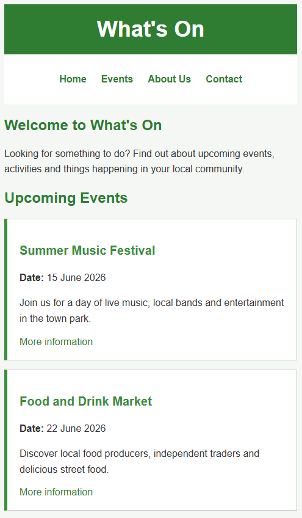
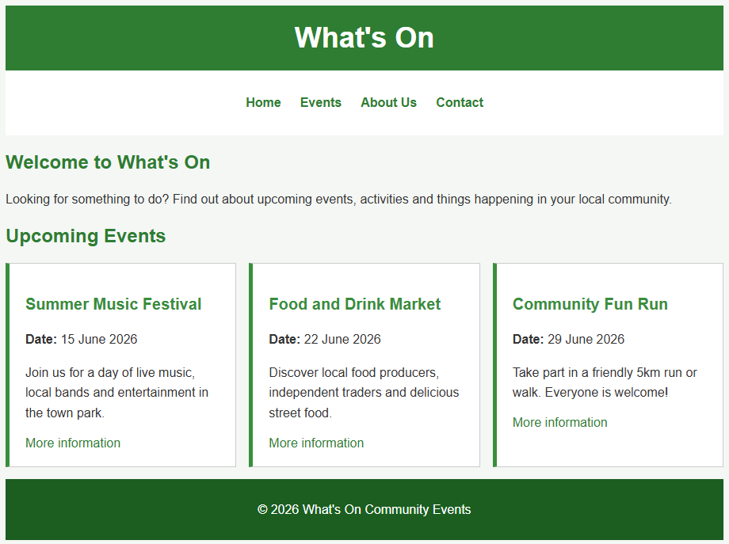

# Introduction to Tailwind

- Open your existing codespace (The one we used in the first four weeks of the module) [https://github.com/codespaces](https://github.com/codespaces).
- In the terminal enter

```
git clone https://github.com/CHT2520-web-prog/tailwind
```

This will copy the contents of this repository into your codespace.

- In terminal, navigate to the _tailwind_ folder

```
cd intro-to-tailwind

```
- Start the web server
```
php -S 0.0.0.0:8000
```

- View the _index.html_ page in a browser. Note, it is a plain HTML page. It has no styling. 

- Link the page to Tailwind by adding the following `<script>` element in the `<head>` section of the document. 

```
<script src="https://cdn.jsdelivr.net/npm/@tailwindcss/browser@4"></script>
```

Test the page, it should now have some basic styling e.g. the font has changed.

Change the opening `<body>` tag to:

```html
<body class="bg-gray-100 font-sans text-gray-800">
```

Refresh the page, see how we have used CSS rules from Tailwind to style the `<body>` element (changed the background colour, the font colour etc.). 

## Mobile First Design

Try and make the page look like the following image by using Tailwind classes. Don't worry if it isn't an exact replica, a rough approximation is fine to get a feel for Tailwind. 




Start with the header part of the page. This only relies on basic properties. Here are some links to Tailwind documentation that should help you style this part of the page.  

- Colours: https://tailwindcss.com/docs/colors
- Padding: https://tailwindcss.com/docs/padding
- Font Size: https://tailwindcss.com/docs/font-size
- Text Align: https://tailwindcss.com/docs/text-align
- Font Family: https://tailwindcss.com/docs/font-family

Once you have a feel for how Tailwind works. Think about how you can style the other parts of the page, the navigation bar, the event cards etc. Use the documentation at https://tailwindcss.com/docs/ to find the right utilities (Tailwind CSS rules) to style the page.  

## Making the Design Responsive

Once you have implemented a basic design, think about how you can make this responsive by creating a 3-column layout for desktop users. 



First, implement the three-columned layout using flex (https://tailwindcss.com/docs/flex) and gap (https://tailwindcss.com/docs/gap). 

Then, think about how you can make it responsive (https://tailwindcss.com/docs/responsive-design). Use the `sm` breakpoint. 
